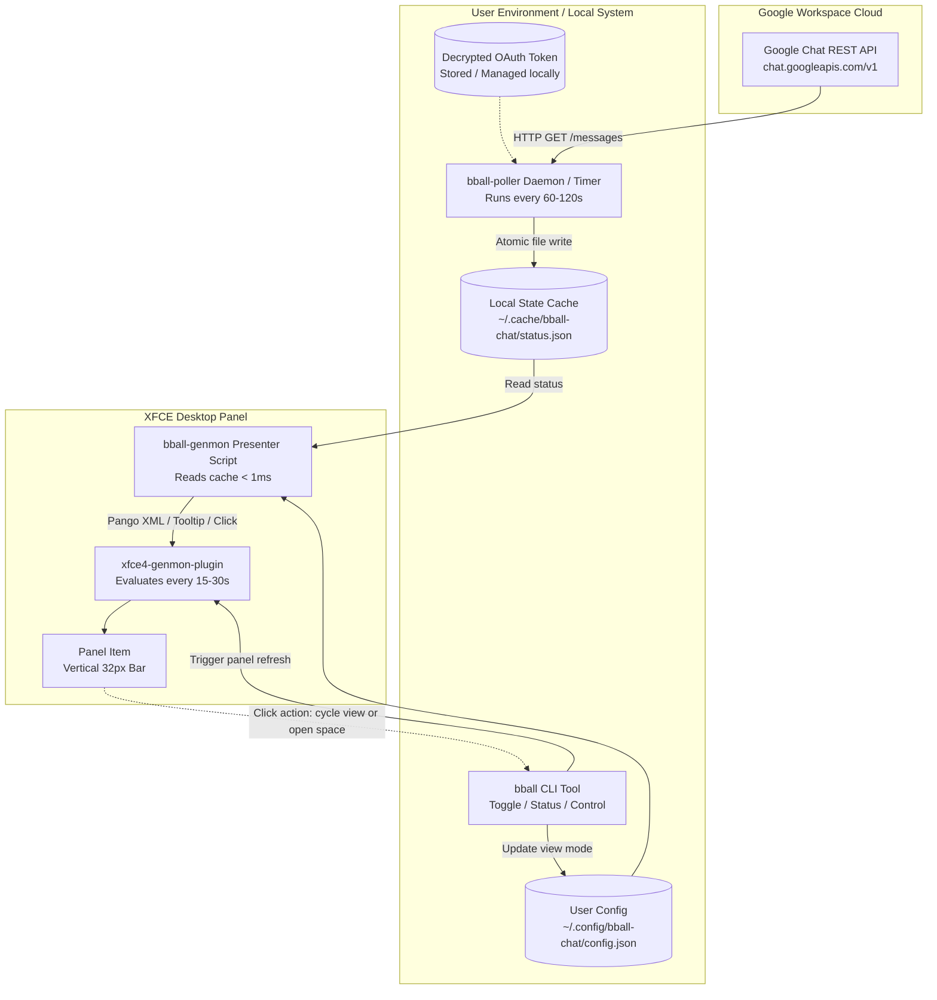

# Architecture Document: Google Chat Pickup Basketball XFCE Panel Widget

## 1. Overview & Goal

The goal of this project is to provide a live, glanceable pickup basketball participant count directly in the XFCE desktop panel.

In Google Chat spaces dedicated to pickup games, organizers post game call announcements (e.g., *"Call for 5-7pm Monday Oct 26th Pickup at MAT1"*), and participants RSVP by reacting with the basketball emoji (`🏀`). This system queries the Google Chat API, tracks the latest game call across configured spaces, aggregates the 🏀 reaction count, and displays the status on the XFCE panel using the Generic Monitor plugin (`xfce4-genmon-plugin`).

---

## 2. System Architecture

The design follows a decoupled producer-consumer pattern. Querying remote Google APIs involves network latency and periodic OAuth token management; by decoupling data fetching into a background worker and using a local cache, the panel UI remains responsive and will never hang or stutter.



---

## 3. Display Format & Site Filtering

### 3.1 Display Ordering & Styling
* **Primary Display**: Basketball emoji followed by MTV count, then Moffett Place count:
  * **Both sites**: `🏀 8 6` (or `🏀 8 / 6`)
    * **1st number**: Lunch bball MTV (`8`)
    * **2nd number**: Moffett Place Basketball (`6`)
  * **Moffett only**: `🏀 6` *(or `🏀 MP 6`)*
  * **MTV only**: `🏀 8` *(or `🏀 MTV 8`)*
* **Hover Tooltip (`<tool>`)**: Always displays full game call details and court locations for both groups regardless of which view mode is active.

### 3.2 Site Switching & Control Mechanisms
The active view mode can be switched easily via three methods:

1. **Interactive Click-to-Cycle**:
   * Clicking the panel item executes `bball toggle`, which cycles the active mode:
     $$\text{all (8 6)} \longrightarrow \text{moffett (6)} \longrightarrow \text{mtv (8)} \longrightarrow \text{all (8 6)}$$
   * Immediately notifies the XFCE panel to redraw with zero lag.
2. **CLI Utility (`bball`)**:
   * `bball moffett` - Switch to Moffett Place only
   * `bball mtv` - Switch to MTV only
   * `bball all` - Switch to both (MTV & Moffett)
   * `bball toggle` - Cycle to the next view
   * `bball status` - Print detailed CLI summary
3. **Configuration File (`~/.config/bball-chat/config.json`)**:
   ```json
   {
     "mode": "all",
     "format": "spaced",
     "poll_interval_seconds": 90
   }
   ```
   * Supported modes: `"all"`, `"moffett"`, `"mtv"`, `"today_only"`.

---

## 4. Component Breakdown

### 4.1 Google Chat API & Authentication Layer
* **Target Spaces**:
  * **Lunch bball MTV**: `spaces/AAAAyHXxedc` (Short code: `MTV`)
  * **Moffett Place Basketball**: `spaces/AAAAA-GT-Xc` (Short code: `MP`)
* **Authentication**:
  * Utilizes Google OAuth 2.0 with the `https://www.googleapis.com/auth/chat.messages.readonly` scope.
  * Reuses local Google Workspace credentials managed via secure local token storage.
  * Tokens are refreshed automatically before expiration.
* **API Endpoints**:
  * `GET https://chat.googleapis.com/v1/{spaceName}/messages?pageSize=10&orderBy=createTime%20desc`

---

### 4.2 Background Poller Service (`bball-poller`)
* **Interval**: Runs every 60–120 seconds.
* **Game Call Detection Heuristic**:
  1. Inspects recent top-level messages (where `threadReply` is absent or false).
  2. Matches game announcement patterns (regex matching `(?i)(call for|game call)` or date/time indicators).
  3. Parses `emojiReactionSummaries`:
     * Primary RSVP target: Unicode `🏀` (`\u{1F3C0}`).
     * Secondary / Maybes: Unicode `❓` (`\u{2753}`).
  4. Records metadata: message author, timestamp, game call text snippet, and space link.
* **Cache Management**:
  * Writes state atomically to `~/.cache/bball-chat/status.json` (writes to `.tmp` then renames).

---

### 4.3 Cache Schema (`~/.cache/bball-chat/status.json`)

```json
{
  "updated_at": "2026-10-26T20:15:00Z",
  "spaces": {
    "mtv": {
      "id": "spaces/AAAAyHXxedc",
      "name": "Lunch bball MTV",
      "short_name": "MTV",
      "active_call": {
        "text": "Game call for Tue, Oct 27, 1145a-115p @GARfield",
        "sender": "wesley c",
        "create_time": "2026-10-26T05:11:49Z",
        "basketball_count": 8,
        "question_count": 1,
        "url": "https://chat.google.com/room/AAAAyHXxedc"
      }
    },
    "moffett": {
      "id": "spaces/AAAAA-GT-Xc",
      "name": "Moffett Place Basketball",
      "short_name": "MP",
      "active_call": {
        "text": "Call for 5-7pm Monday Oct 26th Pickup at MAT1",
        "sender": "Greg Ganger",
        "create_time": "2026-10-26T20:04:52Z",
        "basketball_count": 6,
        "question_count": 0,
        "url": "https://chat.google.com/room/AAAAA-GT-Xc"
      }
    }
  }
}
```

---

### 4.4 Presentation Layer (`bball-genmon`)
* **Execution**: Invoked by `xfce4-genmon-plugin` on a 15–30s cycle.
* **Speed Requirement**: Execution completes in `< 5ms` by reading exclusively from the local cache file and config.
* **Genmon XML Output Specification**:
  * `<txt>...</txt>`: Pango markup rendered on the panel.
    * For a **vertical 32px panel**: formatted to fit cleanly without truncation (e.g. `<span font='Sans Bold 10' foreground='#FFA500'>🏀 8 6</span>`).
  * `<tool>...</tool>`: Multi-line tooltip displayed on hover:
    ```
    Lunch bball MTV:
    • Call: Tue, Oct 27, 11:45a-1:15p @ GARfield
    • RSVP: 8 🏀 (1 ❓)

    Moffett Place Basketball:
    • Call: 5-7pm Monday Oct 26th @ MAT1
    • RSVP: 6 🏀

    [Click to cycle: All -> Moffett -> MTV]
    ```
  * `<click>...</click>`: Calls `bball toggle` to cycle view modes and redraw immediately.

---

## 5. Resilience & Edge Cases

| Scenario | Detection | Fallback Behavior |
| :--- | :--- | :--- |
| **No active game calls** | No messages match call criteria in past 48h | Display `🏀 --` with tooltip indicating no current calls |
| **Network / API failure** | API request errors or timeouts | Keep last cached data for up to 2 hours; dim text color (`#888888`) if cache is stale |
| **Expired OAuth token** | HTTP 401 Unauthorized | Poller triggers token refresh; preserves existing cache during retry |
| **System sleep / resume** | System wakes up | Poller immediately triggers a refresh cycle upon network reconnect |

---

## 6. Deployment & Service Management

1. **Daemon Management**:
   * Run `bball-poller` via a Systemd user service + timer (`~/.config/systemd/user/bball-poller.{service,timer}`) every 90 seconds.
2. **Panel Registration**:
   * Add a `genmon` item via XFCE panel properties pointing to `/home/dcar/projects/bball-chat/bin/bball-genmon`.
